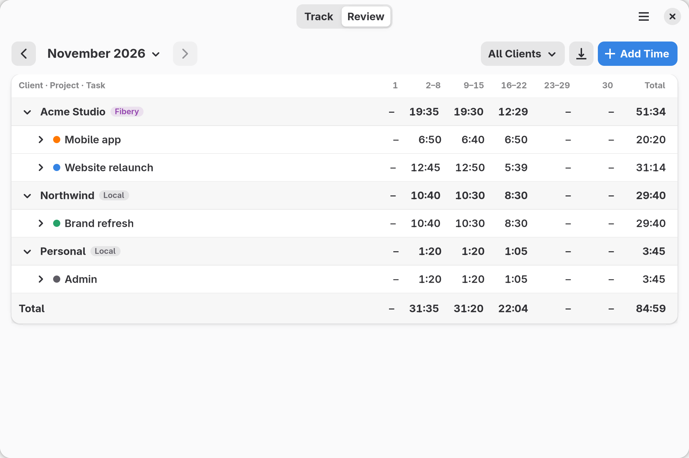

# Time Tracker

A compact GNOME time tracker for freelancers. Track time on your own clients and projects, or on tasks from [Fibery](https://fibery.io), review it per client and project for invoicing, and sync time logs back to Fibery.

Built with Rust, GTK 4 and libadwaita, packaged as a Flatpak.




## Features

- **Timer:** one big start/stop button. Switching tasks stops the running entry and starts a new one. A running timer is saved immediately, so it survives crashes and restarts.
- **Away time:** when you come back after 10 minutes without keyboard or mouse input (or a suspend) while the timer runs, the app asks whether to keep that time, discard it, assign it to another task or stop the timer when you left. The threshold is in Preferences. This uses GNOME's idle monitor (`org.gnome.Mutter.IdleMonitor`), which elementary OS's Gala offers too.
- **Task picker:** fuzzy search over all tasks, recent ones first, filter per client, and create tasks (and projects) on the spot.
- **Review:** a month per client › project › task with a column per week. Click any number to see, edit or add the entries behind it.
- **Clients & Projects:** hourly rates (per client, optionally per project), billable or not, archiving, marking tasks done.
- **Export:** a month's entries as CSV (Ctrl+E).
- **Fibery sync** and **invoice scripts**, see below.
- Light and dark style, adaptive down to a 360 px wide window.

## Fibery

A client can be connected to a Fibery workspace: Clients & Projects → the client → Connect Fibery…. You need your workspace address and an API key, which you create in Fibery under Settings → API Keys.

The app finds the task, project and time log databases and their fields by itself and shows what it found before you connect. The time log database needs at least a link to the task, a date and a number for the hours; optional fields are the user, a note, start and end times, and a "Timing" checkbox on the task. To change what it found, open **Time Logs** on the client page. **Show Tasks** sets which tasks the task picker offers: yours or everyone's, which states, and how long finished tasks stay.

**What syncs**

| From Fibery to the app | From the app to Fibery |
| --- | --- |
| All projects (those in hidden states, by default the finished ones, are archived) | Tasks you create under the connected client, assigned to you |
| The tasks for the picker (by default: assigned to you, not finished) | New, edited and deleted time entries |
| Your own time logs: a year on the first sync, the last two months after that | With **Mirror Running Timer** on: the time log is created when the timer starts and finished when it stops, ticking the task's "Timing" checkbox meanwhile, like Fibery's own timer buttons |
| Time logs deleted in Fibery are removed | |

Hours are sent with two decimals, like Fibery's own timer. Totals in the app use the same rounding, so they match Fibery.

**When:** a full sync at startup, every 5 minutes, when the network comes back and with Sync Now (header bar). Local changes are pushed a few seconds after you make them. Without a connection everything keeps working and syncs later. The sync button in the header bar shows the state, with a dot while entries wait to be sent; its popover lists them, and they're marked in Today and Review too.

**Conflicts:** Fibery wins. If a time log changed in Fibery while a local edit of it was still waiting to be pushed, the Fibery version replaces the local one. Local edits that were pushed are never overwritten by older data.

**The API key** is stored in your system keyring (through the Secret portal). If no keyring is available, it's kept in the app's own database instead and every sync tries to move it to the keyring; the client page says where it's stored. Disconnecting removes the key and keeps the synced data in the app; nothing is removed from Fibery.

## Invoice scripts

An invoice script creates a month's invoice for a client in an invoicing service. Scripts are small Rust modules in [`src/invoicing/`](src/invoicing/), enabled per client under Clients & Projects → the client → Invoicing. In Review, filter on that client and use **Create Invoice**: it shows the lines first and then creates the invoice.

Scripts keep account details out of the code. Rates come from the client and project settings, other details (such as a template invoice) from the script's settings, and API tokens from the keyring.

The included **Moneybird invoice** creates a draft sales invoice in [Moneybird](https://www.moneybird.com) with a line per project, billed in days (8 hours, at the hourly rate × 8). It copies the contact, contact person, VAT and layout from an earlier invoice whose address you paste in the settings, and opens the draft in your browser for final tweaks.

## Keyboard shortcuts

| Shortcut | Action |
| --- | --- |
| Ctrl+T | Start or stop the timer |
| Ctrl+K | Choose a task |
| Ctrl+N | Add time |
| Ctrl+1 / Ctrl+2 | Track / Review |
| Ctrl+Page Up / Ctrl+Page Down | Previous / next month |
| Ctrl+E | Export the month as CSV |
| Ctrl+, | Clients & Projects |
| Ctrl+? | All keyboard shortcuts |
| Ctrl+W / Ctrl+Q | Close / quit |

## Building

The app targets the GNOME 51 runtime (libadwaita 1.8 or newer), so build and run it as a Flatpak rather than against your distribution's libraries.

Install the runtime, SDK and Rust extension once:

```bash
flatpak install --user flathub org.gnome.Platform//51 org.gnome.Sdk//51 org.freedesktop.Sdk.Extension.rust-stable//26.08
```

Build and install the development version (app ID `nl.peteruithoven.TimeTracker.Devel`, with a striped header bar and GNOME's striped nightly icon). Run this from the repository root:

```bash
flatpak-builder --user --install --force-clean build-dir build-aux/nl.peteruithoven.TimeTracker.Devel.json
```

Run it:

```bash
flatpak run nl.peteruithoven.TimeTracker.Devel
```

For the regular version, use `build-aux/nl.peteruithoven.TimeTracker.json` with its own build folder and run `nl.peteruithoven.TimeTracker`:

```bash
flatpak-builder --user --install --force-clean build-dir-release build-aux/nl.peteruithoven.TimeTracker.json
```

Both can be installed side by side, each with its own data. To move your data from one to the other, quit both and copy `data/time-tracker/` and `config/glib-2.0/settings/keyfile` between their folders in `~/.var/app/`. API keys stay behind, as each app has its own keyring: enter them again under New API Key (Fibery) and API Token (invoice scripts) on the client page.

The build fetches crates from crates.io, so it needs network access.

### Faster checks while developing

A full Flatpak build recompiles everything. For quick feedback, run cargo inside the GNOME SDK instead (same library versions, incremental):

```bash
build-aux/cargo-sdk.sh test
```

```bash
build-aux/cargo-sdk.sh clippy
```

The development build keeps its data in `~/.var/app/nl.peteruithoven.TimeTracker.Devel/data/time-tracker/`.

### Screenshots

The screenshots in [`data/screenshots/`](data/screenshots/) (also used in the AppStream metainfo) are rendered from made-up demo data by the installed development build, headless:

```bash
build-aux/screenshots.sh
```

To change what they show, edit the demo data in [`src/demo.rs`](src/demo.rs) or the shots at the bottom of the script.

## Project layout

| Path | What |
| --- | --- |
| `src/` | Rust sources and Blueprint UI files (`*.blp`) |
| `src/store/` | SQLite storage and the store side of syncing |
| `src/fibery/` | Fibery API client, schema detection, network side of syncing |
| `src/invoicing/` | Invoice scripts |
| `data/` | Desktop file, AppStream metainfo, GSettings schema, icons, screenshots |
| `po/` | Translations (gettext) |
| `build-aux/` | Flatpak manifests and helper scripts |

## License

MIT, see [LICENSE](LICENSE).
